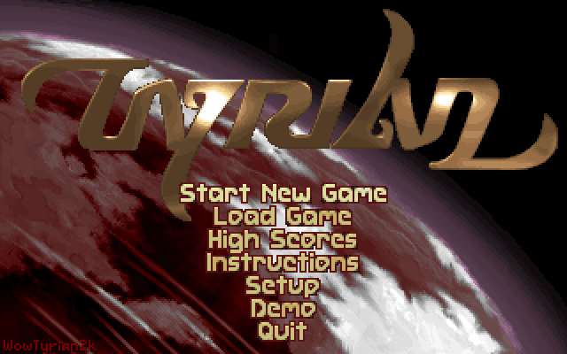
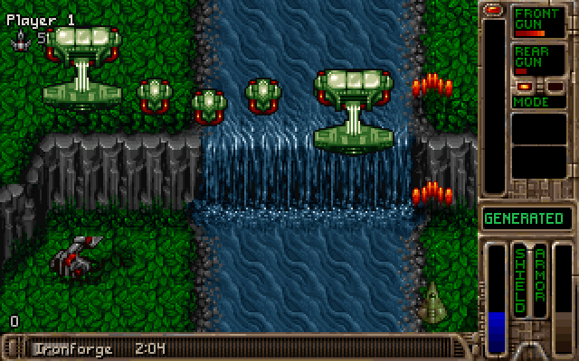
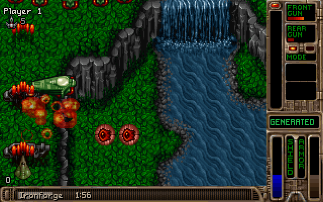
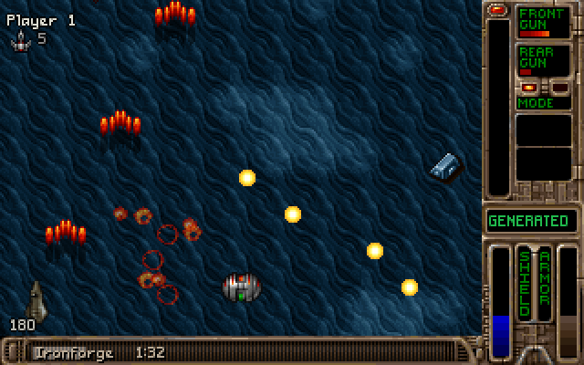
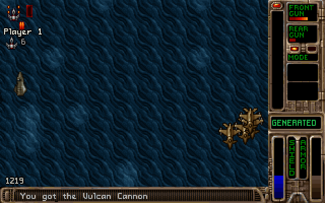
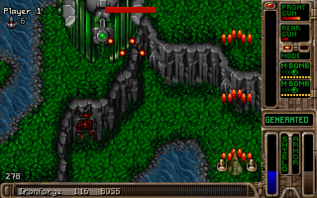

# WowTyrian2k

[OpenTyrian](https://github.com/opentyrian/opentyrian) (Tyrian 2.1) ported to a World of
Warcraft addon. Type `/tyrian` in game to play.

It also adds a **flight path mode**: when you take a flight, the addon offers a generated
arcade level that ends before you land, with a boss at the end.

| | |
|---|---|
|  |  |
| Title screen | A timed level during a flight. The bar at the bottom shows the destination and the flight time left. |
|  |  |
| A generated forest level built from segments of the original maps | Ocean theme |
|  |  |
| Arcade drops: enemies leave power-ups behind | The boss arrives before landing (the `BOSS` tag on the bar) |

*The screenshots show Tyrian's game art and were rendered by the headless test harness
(`tools/harness`).*

## Install

Install it from CurseForge or WowUp, or download
**`WowTyrian2k-v<version>-forever.zip`** from
[Releases](https://github.com/voetre/WowTyrian2k/releases) (releases up to 0.3.1 call it
`-full.zip`). It includes the converted Tyrian data. Unzip it so the folder sits at
`Interface/AddOns/WowTyrian2k`, then restart the game client fully; a `/reload` doesn't
pick up new texture files.

A clone of this repository works too, since it includes the data: copy or link the
checkout to `Interface/AddOns/WowTyrian2k`. The code-only zip needs the data built
first; see [Game data](#game-data).

> Interface 16001 (Classic). Version 0.3.2.

## Changes from OpenTyrian

### The port

- The C sources are translated to Lua and run inside a coroutine. Every place the original
  blocks (waiting for a frame or a key) yields to the WoW client, and `OnUpdate` resumes
  it (`Core/Input.lua`, `Core/Main.lua`).
- **`Game/`** holds the ported OpenTyrian modules. Each file names the C files it replaces:
  `tyrian2.c`, `mainint.c`, `game_menu.c`, `shots.c`, `destruct.c`, `jukebox.c` and so on.
- **`Core/`** replaces SDL and the platform layer:
  - WoW can't upload pixels, so a "surface" is a display list of draw operations
    (`Core/Video.lua`). `Core/Render.lua` turns that list into pooled WoW textures, drawn
    from pre-baked sprite atlases.
  - The palette is kept apart from a full-screen fade overlay, so palette fades still
    look right (`Core/Palette.lua`).
  - Sound effects and pre-rendered OPL music play as `.ogg` files through the WoW sound
    system (`Core/Sound.lua`).
  - Keyboard input is mapped from WoW key names to SDL scancodes.
  - Configuration and saved games go to the `WowTyrian2kDB` saved variable instead of
    `tyrian.cfg` and `tyrian.sav`.
- The Destruct mini-game keeps its terrain as a Lua array and redraws only the columns
  that changed.
- **Removed:** multiplayer, network play, two-player mode and joystick configuration.
  - The menus now say "Game Mode", "Full Game", "Arcade" and "Saved Games".
  - The Galaga secret level's docking second ship still works.

### Flight path mode (new)

- **Flight timing** (`Core/Flight.lua`) estimates how long a flight lasts. It uses, in
  order of preference:
  1. your own recorded time for that exact route
  2. Flight Timer Classic's data (`Core/FlightData.lua`, CC BY 2.0)
  3. a fitted distance/hop model

  Every completed flight is recorded and used for later estimates.
- **Flight toast** (`Core/FlightPrompt.lua`): a draggable toast. It shows the
  destination, a countdown and a progress bar, and asks *"Play Tyrian? (m:ss level)"*.
  - It never takes the keyboard.
  - It fades away by itself when too little flight is left.
- **Flight bar:** during a level, the strip at the bottom of the screen shows the
  destination, the flight time left and a fill bar. It adds `BOSS` while the boss fight
  is on, then `BOSS DESTROYED`.
- **Bonus level:** if you beat the boss with at least 70 seconds of flight left, you're
  offered one of Tyrian's secret levels (Fire to play, Esc to skip). It ends 10 seconds
  before landing, or earlier if you die or the level finishes. It has no shop and isn't saved.
  Both times can be changed in the options.
- **Score card:** when a generated level (and any bonus level) is over, a card shows the
  run's stats: time, boss, drops, kill rate, bonus level and score. Fire or Esc closes the
  game, and the next `/tyrian` or flight starts fresh. Every run is recorded on the
  Statistics options page.

### Level generator (new)

- `Game/LevelGen.lua` builds endless background maps from segments of the original
  levels.
- `tools/levgen/build.py` cuts the original maps into segments and builds a graph of
  which segment may follow which, joining some with generated bridge rows.
- Every 2x2 tile window along each join occurs in a real map, so the joins have no
  visible seams.
- Themes: `forest` and `ocean`. Enemy waves come from the same source levels.
- **Timed levels** last a fixed time. They end with a boss section from the source level,
  plus an overtime limit.

### Arcade play in timed levels (new)

Power scales with how short the level is:

    power = (900 - seconds) / 825, clamped to 0..1

A 2-minute level is at about 95%; a 10-minute level is at about 36%.

| What | How it scales |
|---|---|
| Front gun starting power | 2 + 4 × power (front power doubles as lives, as in arcade mode) |
| Drop chance per kill | 12% + 13% × power |
| Drop weights | power-up 3 + 4p, purple ball 3, armour 2, bomb 1 + p |
| Difficulty | each ramp step adds round(power); the boss adds 3 × power |

- **Enemy density:** more waves are kept (80/100/100%, up from 50/75/100%), and the enemy
  frequency is capped at 95/93/90.
- **Music:** each level picks a random song, seeded from the level seed.

### Other additions (new)

- **Options** under Options > AddOns > WowTyrian2k. The top page has the Tyrian logo,
  a "Play Tyrian" button, how to play and the credits; the settings are on its
  sub-pages:
  - **Game:** skip intro logos, game speed (a dropdown).
  - **Sound:** music and effects toggles and volumes, and whether the WoW volume sliders
    follow the game's.
  - **Window:** window scale (1-6×), lock the window (its position is remembered),
    opacity, the minimap button, whether closing the window pauses or ends the game, what entering combat
    does (hide and pause, hide and end, or keep playing), and hiding for ready checks,
    queue pops and whispers.
  - **Flight Mode:** what happens when a flight starts (ask, start a game, or nothing),
    flight time chat messages, the flight bar, the theme, the shortest game offered, how
    long before landing a level ends, and forgetting recorded flight times.
  - **Generated Levels:** difficulty (−2 to +2), a fixed arcade power instead of one set
    by the level length, drop rate, enemy density, random music, bonus levels and the
    flight time they need, the score card and its music, and going back to the title
    screen after a run instead of closing.
  - **Statistics:** lifetime totals, the best score for each theme and the last 20 runs.
  - **Cheats:**
    - infinite shield, armour, generator power and sidekick ammo
    - invincibility, instant kill, unlimited credits
    - **All shop items:** every item from any episode's shop, in scrolling lists
    - **Secret items:** for example the Nort Ship, Stalker and Banana Blast
    - the number of lives a flight mode level starts with, and an option to turn
      every cheat off during flight mode levels
  - **Advanced:** debug messages, the performance meter, clearing debug dumps,
    restarting the game and resetting every setting.
- **Jukebox controls** (Setup > Jukebox): a panel under the game window, styled like the
  WoW settings window, with:
  - the song's title, track number and a progress bar (WoW can't seek or pause music, so
    the bar shows the position only)
  - shuffle, previous, play/stop, next and loop buttons
  - visualizer dropdowns for pattern, speed and colours, auto-change and reset
  - a track list beside the panel that can be folded away, and a compact mode that shows
    just the title, progress and media buttons

  The keys still work: Left/Up previous, Right/Down/Enter next, Space play/stop, Esc
  leaves. The song keeps playing when you go back to the title screen, and the WoW music
  is put back the way it was when the game closes. The layout, loop, title-on-screen and
  visualizer settings are saved between sessions; shuffle always starts off.
- **Window frame** in the same style. The title bar shows:
  the screen (Title Screen, Jukebox, Upgrade Ship, Paused...), the episode and level,
  the difficulty and score while playing, the song in the jukebox, and on a flight the
  destination and time left.
- **Minimap button** showing the USP Talon, the ship you start with: left-click plays
  or hides the game (like `/tyrian`), right-click opens the options, drag to move it
  round the minimap. It uses LibDBIcon, so minimap button addons can gather or hide it.
- **Key binding:** "Show or hide Tyrian", under Key Bindings > AddOns. It also closes the
  window while the game has the keyboard.
- Esc (or Quit) on the title screen closes the game.
- **Debug dump** (F12 or `/tyrian dump`) records:
  - the level, scroll positions and layer draw order
  - every live enemy and the event that spawned it
  - the arcade state

  It opens in a window ready to copy and is kept in the saved variables.
- **Performance meter** (`/tyrian perf`): game ticks per second and frame cost.

## Slash commands

`/tyrian` or `/wt2k`:

| Command | What it does |
|---|---|
| *(none)* | Show or hide the game |
| `scale <1-6>` | Window scale |
| `options` | Open the options page |
| `reset` | Reset the window position and size |
| `restart` | Restart the game (saved games are kept) |
| `genlevel [forest\|ocean] [seed]` | Play an endless generated level |
| `timedlevel <2m\|120\|4:30> [theme] [seed]` | Play a timed generated level that ends with a boss |
| `flighttest <duration> [theme] [seed]` / `flighttest stop` | Fake a flight, to try the toast and flight bar |
| `flightprompt` | Turn the flight toast on or off (see the Flight Mode options for more) |
| `flights` | Turn flight time chat messages on or off |
| `dump` | Make a render state dump (also F12) |
| `perf` | Turn the performance meter on or off |
| `stats` | Show memory use |
| `debug` | Turn debug logging on or off |

## Game data

The converted Tyrian data is included in this repository (`Textures/`, `Sound/` and
`Data/`) and in the release's full zip. It is not covered by the GPL; see
[DATA-NOTICE.txt](DATA-NOTICE.txt) for where it comes from and who made it.

To rebuild it yourself from the freeware Tyrian 2.1 files
([tyrian21.zip](https://camanis.net/tyrian/tyrian21.zip)):

```sh
# Sprites, tiles and pictures -> Textures/*.tga; game data files -> Data/*.lua
python3 tools/convert.py <tyrian21 dir> .

# Level generator library -> Data/levgen.lua
python3 tools/levgen/build.py <tyrian21 dir> .

# Minimap icon: the USP Talon from Textures/sheet_ship9.tga -> Textures/icon.tga
python3 tools/make_icon.py .

# Jukebox media button icons -> Textures/media.tga
python3 tools/make_media_icons.py .

# Sound effects -> Sound/sfx/sfxNN_vV.ogg (needs ffmpeg)
python3 tools/make_sfx.py <tyrian21 dir> Sound/sfx
```

**Music** is pre-rendered from `music.mus`:

1. Build `tools/music_render/render.c` against OpenTyrian's `lds_play.c` and `opl.c`.
2. Run it as `render <music.mus> <out dir> [max seconds]`. It writes one
   `songNN.raw` file (signed 16-bit, 44.1 kHz) per song.
3. Encode each file to `Sound/music/songNN.ogg` with ffmpeg.

Then copy the folder to `Interface/AddOns/WowTyrian2k`. The `.toc` file lists the
generated `Data\*.lua` files, so the addon won't load until they exist.

Other tools:
- `tools/anm.py` decodes ANM animations.
- `tools/flight/convert_ftc.py` regenerates `Core/FlightData.lua` from Flight Timer
  Classic's `Data.lua`.
- `tools/levgen/preview.py` and `tools/levgen/check.py` preview and check the generated
  maps.

## Headless test harness

`tools/harness/` runs the addon outside WoW under LuaJIT, using a mock WoW API
(`wow_mock.lua`, `mock_extra.lua`). It loads the files in `.toc` order and steps the game
frame by frame. It can press keys at given frames and dump the render state at given
frames. `compose.py` turns those dumps into PNGs using the built textures; the
screenshots above were made this way.

```sh
cd tools/harness
luajit run_opts.lua <addon dir> <frames> "<frame:key,...>" "<dump frames>"
python3 compose.py <addon dir> dump_*.txt
```

## Licence and credits

- **WowTyrian2k** is licensed under the GNU General Public License, version 2 or later
  (see [COPYING](COPYING)).
  - Lua port Copyright (C) 2026 voetre.
  - Based on [OpenTyrian](https://github.com/opentyrian/opentyrian), Copyright (C) The
    OpenTyrian Development Team.
- **Tyrian** (c) 1995 Epic MegaGames and Eclipse Software, released as freeware as
  Tyrian 2.1. Programming and level design by Jason Emery; story and music by Alexander
  Brandon; level artwork by Daniel Cook; with Robert Allen, Arturo Sinclair, Bruce Hsu,
  John Calcagno, Andrew Paquette, Andreas Molnar, Susan Aldworth and Nando Eweg. The full
  list is in [DATA-NOTICE.txt](DATA-NOTICE.txt).
  - Daniel Cook released his Tyrian ship and tile graphics for free use in 2007:
    [Lost Garden](https://lostgarden.com/2007/04/05/free-game-graphics-tyrian-ships-and-tiles/).
  - The game data (`Textures/`, `Sound/`, `Data/`) is not covered by the GPL.
- **Flight times** in `Core/FlightData.lua` come from
  [Flight Timer Classic](https://github.com/timohausmann/FlightTimerClassic) by
  timohausmann, licensed under
  [CC BY 2.0](https://creativecommons.org/licenses/by/2.0/). They were reformatted as a
  Lua table; the times themselves are unchanged.
- **Libraries** in `Libs/`, unchanged: LibStub, CallbackHandler-1.0, LibDataBroker-1.1
  and LibDBIcon-1.0, by their authors under their own terms.
- World of Warcraft is a trademark of Blizzard Entertainment. This project is not
  affiliated with Blizzard or with the OpenTyrian project.

See [TODO.md](TODO.md) for planned work and [KNOWN_BUGS.md](KNOWN_BUGS.md) for open
issues.
